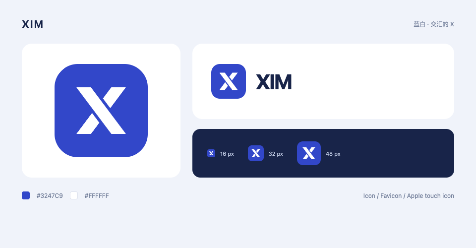

# XIM 图标

以两条交错的白色笔画构成 X，表达消息往来与连接。纯蓝圆角底在浅色、深色背景中保持一致。

- 品牌蓝：`#3247C9`，与页面主题色一致。
- 白色：`#FFFFFF`。
- 页面标记：图形与 XIM 名称组合；标签页仅使用图形。

## 资源

| 文件 | 用途 |
| --- | --- |
| `frontend/public/icon.svg` | 矢量源文件、页面图标、现代浏览器 favicon |
| `frontend/public/icon.png` | 512 × 512 PNG，透明圆角外侧 |
| `frontend/public/favicon.ico` | 内含 16、32、48 像素版本 |
| `frontend/public/apple-touch-icon.png` | 180 × 180，实心蓝色背景，由 iOS 应用圆角 |

修改 SVG 后，在 `frontend` 目录运行 `npm run icons:generate`，再构建前端。导出脚本使用现有 Playwright 依赖和本地 Chrome；也可以通过 `XIM_BROWSER_CHANNEL` 指定已安装的浏览器通道。
