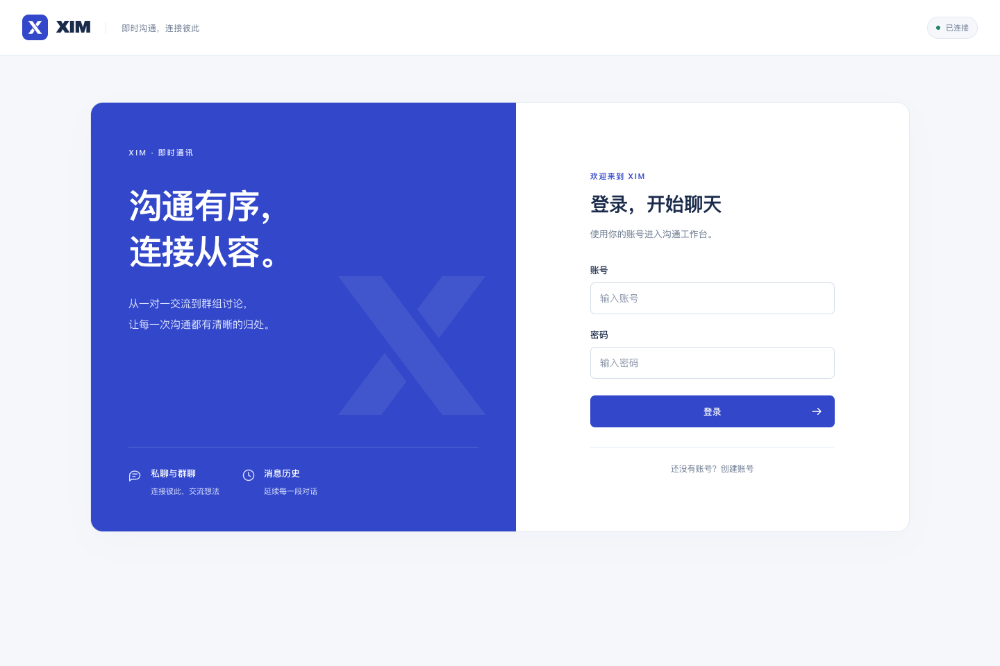
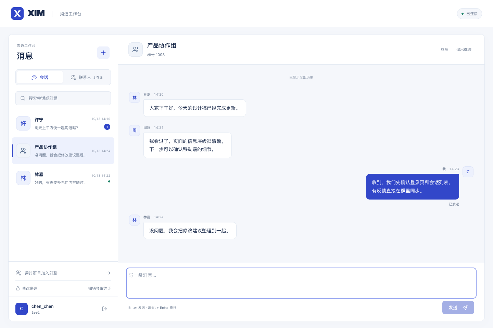

# XIM 前端视觉设计

面向日常工作沟通，以登录、查找联系人、私聊和群聊为主要任务。蓝白商务风格沿用 XIM 图标，用清晰的信息层级与克制的装饰突出对话内容。

## 视觉约定

| 角色 | 色值 |
| --- | --- |
| 品牌蓝、主要操作、自己的消息 | `#3247C9` |
| 浅蓝、选中会话 | `#EDF1FD` |
| 主文字 | `#1B2B4B` |
| 次要文字 | `#66758C` |
| 页面与消息区背景 | `#F5F7FB` |
| 表单、侧栏、接收消息 | `#FFFFFF` |

标题与品牌使用 Avenir Next / PingFang SC，正文使用系统无衬线字体，账号 ID 使用等宽字体。全部字体来自系统，无需在线加载。控件保持 7–12 像素圆角，蓝色仅用于品牌、主要操作与选中状态。

登录页采用品牌区与表单区的双栏结构，放大的交错 X 是唯一的大型图形。聊天工作区采用白色侧栏、浅色消息背景，自己与他人的消息通过颜色和位置区分。手机端在会话列表与对话之间切换，保留返回按钮。

## 验证记录

- TypeScript 检查与 Vite 生产构建通过。
- 浏览器使用模拟 WebSocket 响应检查登录失败、注册反馈、联系人搜索、私聊与群聊、Enter 发送、成员与账号弹窗、手机返回；未向真实后端写入数据。
- 检查 320、390、680、768、1024、1440 像素宽度，无横向溢出，发送区在视口内；支持可见键盘焦点与减少动态效果偏好。
- 前端测试运行结果为 64 项通过、3 项消息恢复测试失败。失败测试只导入通讯与协议代码，没有导入界面组件；本次没有修改通讯与消息恢复逻辑。
